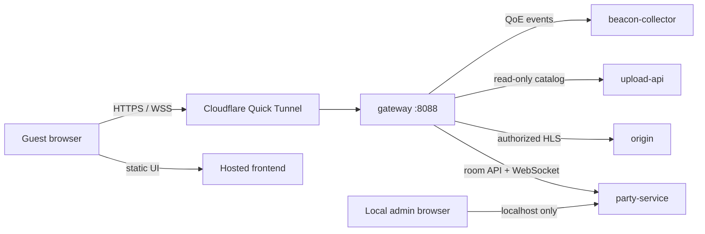
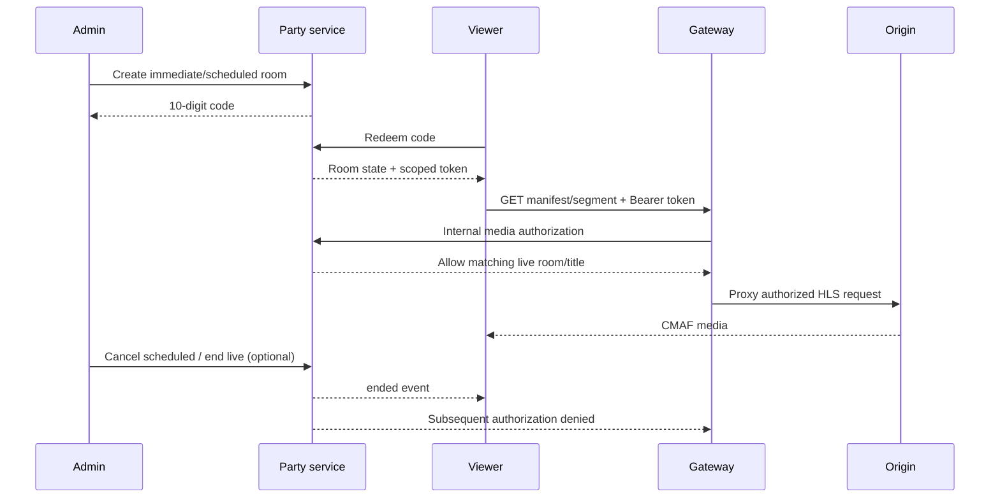
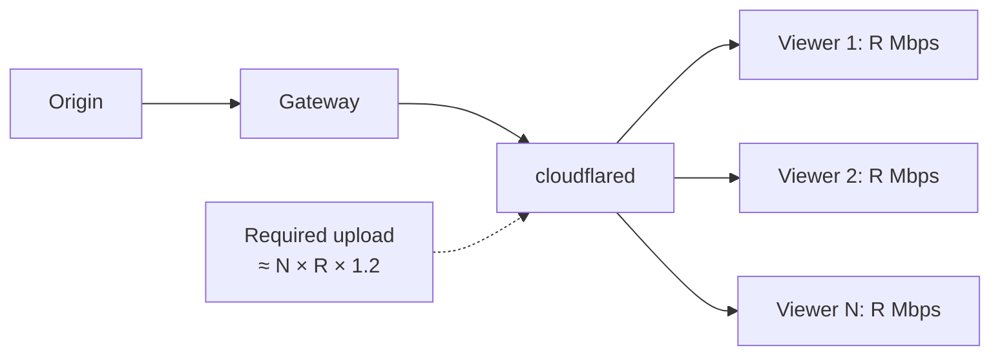

# Cloudflared watch-party deployment

This is the single-node deployment. The admin laptop stores and transcodes the
video, hosts the local admin UI, and exposes only the viewer API, HLS media, and
party service through a free Cloudflare Quick Tunnel. No relay server is used.



## One-time setup

1. Copy `.env.example` to `.env` and replace every `change-this-*` value. Generate
   `PARTY_ADMIN_TOKEN` with `openssl rand -hex 32`.
2. Deploy `frontend/` as a Node web service (Render is the documented default):
   build command `npm ci && npm run build`, start command `npm start`, root
   directory `frontend`, and environment variable `NEXT_PUBLIC_VIEWER_ONLY=1`.
3. Put the resulting HTTPS URL in `.env` as `VIEWER_URL`.
4. Start the local stack with `./start.sh` and upload/transcode a title in
   `http://localhost:3001/admin`.

## Start and share a party

1. Run `./start.sh --tunnel`. This starts the gateway, party service, and
   Cloudflared, verifies the public endpoint, and prints a viewer link containing
   the temporary backend address.
2. Open the printed viewer link once on each viewer device. The frontend stores
   the current tunnel address in that browser.
3. In the local admin UI, choose a ready title under **Create a watch party**.
   Optionally choose a scheduled time, then copy the generated 10-digit code.
4. Guests open the hosted frontend, visit `/party`, and enter that code. A
   scheduled title remains locked until its start time.

The 10-digit code is redeemed for a short-lived, room-and-title-bound viewer
session. The gateway checks that session on every HLS manifest and segment;
knowing or copying a media URL is not enough to play it. Lobby artwork remains
public so scheduled rooms can show their presentation screen. Sessions stop
working when the room completes, the operator ends a live room, or the operator
cancels a scheduled room.



## Local tunnel rehearsal

Use the same flow locally before deploying the viewer frontend:

```bash
./start.sh --tunnel
```

1. Keep the admin studio at `http://localhost:3001/admin`.
2. Copy the temporary `https://*.trycloudflare.com` backend URL printed by the
   script.
3. Open the printed viewer link, which stores that backend URL for the browser,
   or use the viewer-only frontend described below.
4. Create a party in the admin studio, then open `/party` and enter its code.
5. Confirm that `http://localhost:3001/` sends a signed-out viewer to the code
   gate rather than playing a catalog title directly.

To inspect the local public boundary without exposing it, use
`http://127.0.0.1:8088/healthz`. Raw `/hls/<movie_id>/master.m3u8` requests must
return `401` without a redeemed party session.

## Viewer behavior

- The server clock determines the broadcast position. Guests cannot pause,
  seek, or change playback speed for the room.
- Quality, captions, volume, and fullscreen remain local to each viewer and do
  not change another viewer's experience.
- Scheduled media remains unavailable until the configured curtain time. When
  it arrives, clients catch up to the authoritative position automatically.
- Browser autoplay rules may start the synchronized stream muted until the
  viewer interacts with the page.
- `Connecting` and `Reconnecting · N` describe the party WebSocket used for
  presence, chat, readiness, and telemetry; HLS media delivery is separate.
- Typing in chat consumes keyboard input, so Space no longer pauses or resumes
  the player.

## Operations and privacy

The admin observability screen shows party title/state, connected and ready
counts, playback position, country (when Cloudflare supplies it), drift, and
estimated bitrate. Client IPs are displayed only as a keyed, truncated hash;
the party service does not expose raw IP addresses in its admin response.

The control-room table has a bounded vertical viewport and sticky header. Search
matches title, room code, or lifecycle state. The compact table shows at most two
viewer summaries per room; **Inspect** opens room-specific telemetry with all
current connections, average drift, average reported bitrate, and recent room
events. Invite codes remain masked until the operator explicitly reveals them.

Lifecycle labels are terminal and auditable:

- **Completed** — the configured title duration elapsed;
- **Cancelled** — an admin stopped a scheduled room before its start time;
- **Ended by admin** — an admin stopped a live presentation.

The timeline records scheduled/started and ended timestamps. A completed room
cannot continue authorizing HLS, even if a browser retained its old media URL.

Party metadata is durable in DynamoDB-local. Live sockets, participant details,
and recent events are intentionally in memory for this single-node version and
reset when `party-service` restarts.

Quick Tunnel hostnames change whenever Cloudflared restarts and may be reclaimed
after idle periods. Re-run `./start.sh --tunnel` and share/open the newly printed
viewer link when that happens. For a stable production URL, replace the Quick
Tunnel with a named Cloudflare Tunnel and a domain.

The gateway rejects upload/catalog mutations; administration remains on the
local UI. Party creation additionally requires the same Basic credentials used
by the admin studio.

## Capacity planning

The single-node path sends a separate HLS copy through the operator's upload
link for every viewer. For average delivered bitrate `R`, viewer count `N`, and
20% protocol/safety overhead:

$$
B_{upload} \approx N \times R \times 1.2
$$



Use sustained upload—not download speed or Ethernet/Wi-Fi link rate—for the
capacity calculation. Keep 20–30% headroom and test the worst allowed rendition.
The current ladder peaks around 2.5 Mbps at 720p, 5 Mbps at 1080p, 12 Mbps at
1440p, and 24 Mbps at 2160p before audio and overhead. Adaptive bitrate helps
slower viewers but does not provide multicast or peer sharing.

Quick Tunnels are suitable for development and small private tests. They have no
uptime guarantee, use a temporary hostname, and impose a 200 in-flight-request
limit. HLS generates multiple simultaneous requests per viewer, so this limit
must not be interpreted as support for 200 viewers. Move to a named Cloudflare
Tunnel for a stable hostname and production connector management; move media to
object storage plus a CDN or dedicated relay when the operator's upload link is
the bottleneck.

## Failure recovery

If every viewer reports `manifestLoadError` at the same time, inspect gateway
logs before retranscoding the title:

```bash
docker compose logs --tail=100 gateway origin party-service
docker compose --profile tunnel ps
```

After an origin container is recreated, an already-running Nginx gateway may
still hold the origin's previous Docker address. Refresh only the gateway after
the origin is healthy:

```bash
docker compose --profile tunnel up -d --no-deps --force-recreate gateway
curl -fsS http://127.0.0.1:8088/healthz
```

An authorized segment returning `200` confirms the media path. A `401` without a
room token and a `403` after room completion are expected gate behavior. Do not
restart or retranscode the entire stack for a stale gateway upstream address.

## Promotion path

Merge feature work into `dev` first. Run the frontend build/tests, Compose
configuration validation, nginx configuration test, and anonymous/authorized
HLS checks there. Promote `dev` to `main` only after those checks pass and the
deployment documentation matches the release. Do not merge a feature branch
directly into `main`.
